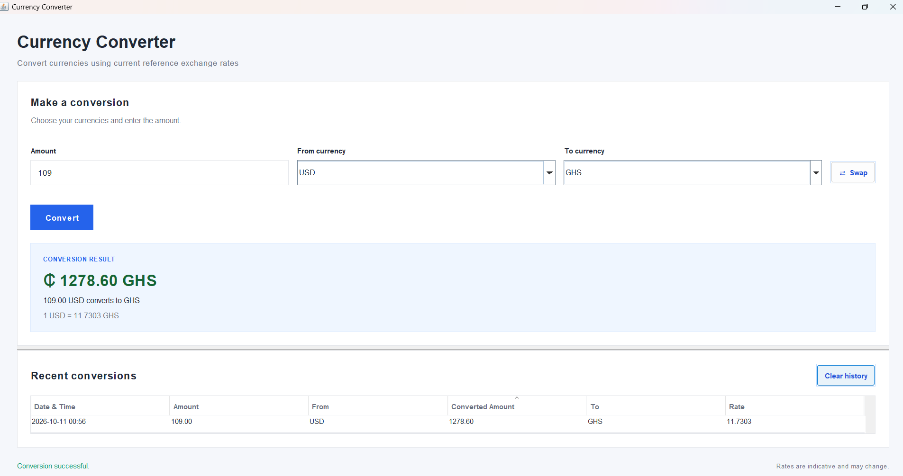

# Currency Converter

A Java desktop application for converting amounts between currencies using reference exchange rates from the [Frankfurter API](https://frankfurter.dev/).

Built with **Java, Java Swing, and Maven**, this project features a graphical user interface, dynamically loaded currencies, precise decimal calculations, exchange-rate caching, and persistent conversion history.

**[Download Currency Converter for Windows — v1.0.0](https://github.com/Dammy-The-Traveller/CurrencyConverter/releases/tag/v1.0.0)**



## Features

- **Desktop GUI:** A graphical interface built with Java Swing.
- **Reference exchange rates:** Retrieves exchange rates from the Frankfurter API.
- **Dynamic currency discovery:** Loads supported currencies from the API.
- **Accurate calculations:** Uses `BigDecimal` for monetary calculations.
- **Currency selection:** Select source and target currencies from dropdown menus.
- **Currency swapping:** Quickly reverse the selected currencies.
- **Input validation:** Handles invalid amounts and unsupported currency selections.
- **Exchange-rate caching:** Caches successful exchange rates in memory for up to 24 hours.
- **Conversion history:** Displays previous conversions, including timestamps.
- **Persistent history:** Saves conversion records to a local JSON file.
- **History management:** Allows users to clear conversion history.
- **Responsive interface:** Uses `SwingWorker` to perform network requests without blocking the GUI.
- **Error handling:** Handles API errors, network failures, and request timeouts.
- **Offline fallback:** Can use available fallback or cached data when live data is unavailable, depending on the operation.
- **Automated testing:** Includes unit tests for conversion logic and history management.
- **Executable JAR:** Packages the application and its dependencies using Maven Shade Plugin.
- **Windows distribution:** Includes a self-contained Windows application and an installer.

## Download and Installation

### Windows

The latest release is **v1.0.0**.

**[Go to Currency Converter v1.0.0 on GitHub Releases](https://github.com/Dammy-The-Traveller/CurrencyConverter/releases/tag/v1.0.0)**

1. Open the release page.
2. Download `Currency Converter-1.0.0.exe` from the Assets section.
3. Run the installer if Windows allows it.
4. Follow the installation prompts and launch Currency Converter.

The Windows package includes a Java runtime, so a separate Java installation should not be required.

**Windows security notice:** The installer is currently unsigned. Windows Smart App Control may block it because the publisher cannot be verified. This warning does not, by itself, establish whether an application is malicious. Do not disable Windows security protections simply to install this application.

### Build from source

#### Requirements

- JDK 21 or a compatible Java development environment
- Apache Maven
- Internet access for retrieving fresh currency information and exchange rates

#### 1. Clone the repository

```bash
git clone https://github.com/Dammy-The-Traveller/CurrencyConverter.git
cd CurrencyConverter
```

#### 2. Build the application

```bash
mvn clean package
```

Maven compiles the source code, runs the automated tests, and creates the executable JAR.

The packaged JAR is generated at:

```text
target/CurrencyConverter-1.0-SNAPSHOT.jar
```

#### 3. Run the application

```bash
java -jar target/CurrencyConverter-1.0-SNAPSHOT.jar
```

The graphical interface should open.

Alternatively, open the project in an IDE such as Visual Studio Code and run `Main.java` with the Maven dependencies available.

#### 4. Run the tests

```bash
mvn clean test
```

## Technologies

- Java 21-compatible source and bytecode
- Java Swing
- Apache Maven
- Frankfurter Exchange Rates API
- Java HTTP Client
- Jackson Databind
- JUnit 5
- `BigDecimal`
- JSON-based persistence
- `jpackage` and WiX Toolset for Windows packaging
- Git and GitHub

## Supported Currencies

The application retrieves its supported currency list dynamically from the Frankfurter API. The number of available currencies depends on the API response and the currencies supported by the service.

The application successfully loaded 165 supported currencies during testing.

Currency availability may change, and not every currency is necessarily available for every exchange-rate request.

## Exchange Rate Information

Exchange rates and currency information are retrieved from the [Frankfurter API](https://frankfurter.dev/).

Successful exchange rates are cached in memory for up to 24 hours. This in-memory cache is cleared when the application restarts.

**Important:** These are reference exchange rates, not guaranteed bank, card, remittance, or cash-exchange transaction rates. Financial institutions and payment providers may apply different rates, fees, and spreads.

When live data cannot be retrieved, the application may use available fallback currency data or cached rates where supported. Offline conversions may therefore use outdated rates and should not be treated as current market quotes.

## Conversion History and Data Persistence

Conversion history is saved locally in a JSON file.

On Windows, the default history location is:

```text
%APPDATA%\CurrencyConverter\conversion-history.json
```

The application stores conversion details such as the amount, source and target currencies, exchange rate, converted amount, and timestamp.

History is loaded when the application starts, allowing previous conversions to remain available between sessions.

**Privacy note:** The history file is stored locally and is not encrypted. It should not be treated as secure financial record storage.

## Project Structure

```text
CurrencyConverter/
├── pom.xml
├── README.md
├── .gitignore
├── image.png
├── src/
│   ├── main/
│   │   └── java/
│   │       └── com/
│   │           └── damilare/
│   │               └── currencyconverter/
│   │                   ├── Main.java
│   │                   ├── Currency.java
│   │                   ├── CurrencyConverter.java
│   │                   ├── ExchangeRateService.java
│   │                   ├── ExchangeRateResponse.java
│   │                   ├── Conversion.java
│   │                   ├── ConversionHistory.java
│   │                   ├── InputHandler.java
│   │                   ├── CurrencyService.java
│   │                   └── CurrencyConverterGUI.java
│   └── test/
│       └── java/
│           └── com/
│               └── damilare/
│                   └── currencyconverter/
│                       ├── CurrencyConverterTest.java
│                       └── ConversionHistoryTest.java
├── target/      # Generated Maven build files
└── release/     # Generated Windows packages
```

The `target/` and `release/` directories contain generated build artifacts.

## Testing Status

The project has successfully passed its current automated test suite:

- **13 tests executed**
- **0 failures**
- **0 errors**
- **0 skipped**

Manual testing has confirmed that the packaged application launches, performs conversions, and can save conversion history to the expected application-data location.

## Release Information

| Item | Details |
|---|---|
| Current release | v1.0.0 |
| Release type | Initial stable release |
| Platform package | Windows |
| Installer | `Currency Converter-1.0.0.exe` |
| Source code | Available in this repository |

**[View the latest release and download the installer](https://github.com/Dammy-The-Traveller/CurrencyConverter/releases/latest)**

## Roadmap

- [x] Implement currency-conversion logic
- [x] Integrate reference exchange rates
- [x] Use `BigDecimal` for calculations
- [x] Add input validation and error handling
- [x] Add exchange-rate caching
- [x] Add conversion history and timestamps
- [x] Persist history using JSON
- [x] Load supported currencies dynamically
- [x] Build a Java Swing desktop GUI
- [x] Add automated unit tests
- [x] Package the application as an executable JAR
- [x] Build a self-contained Windows application
- [x] Generate and publish a Windows installer
- [ ] Improve offline-rate transparency in the interface
- [ ] Perform further usability and cross-environment testing
- [ ] Digitally sign the Windows installer

## Contributing

This is a learning and portfolio project. Suggestions, bug reports, and constructive feedback are welcome.

## Author

**Damilare David Adebesin**

- **Portfolio:** [damilare-david-adebesin.onrender.com](https://damilare-david-adebesin.onrender.com/)
- **GitHub:** [Dammy-The-Traveller](https://github.com/Dammy-The-Traveller)
- **Project repository:** [CurrencyConverter](https://github.com/Dammy-The-Traveller/CurrencyConverter)
